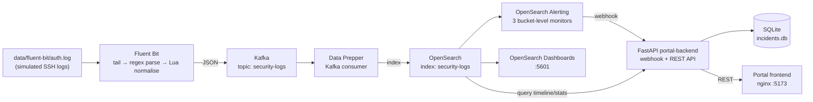

# SIEM-Lab

A containerised Security Information and Event Management (SIEM) lab for detecting and investigating SSH attacks.

The stack ingests simulated `auth.log` events, streams them through Kafka into OpenSearch, runs scheduled Alerting monitors for brute-force, compromise and password-spraying patterns, and turns the resulting alerts into incidents in a small SOC portal backed by FastAPI and SQLite.

> **Status:** reference/demo lab, not a production SIEM. Security plugins are disabled and the API has no authentication.

---

## Contents

- [What it does](#what-it-does)
- [Architecture](#architecture)
- [Detection rules](#detection-rules)
- [Tech stack](#tech-stack)
- [Getting started](#getting-started)
- [Make targets](#make-targets)
- [Access points](#access-points)
- [Demo scenarios](#demo-scenarios)
- [API reference](#api-reference)
- [Event schema](#event-schema)
- [Configuration](#configuration)
- [Project layout](#project-layout)
- [Verification](#verification)
- [Dashboards](#dashboards)
- [Troubleshooting](#troubleshooting)
- [Security notes and limitations](#security-notes-and-limitations)
- [Further reading](#further-reading)

---

## What it does

- **Collect** — Fluent Bit tails `data/fluent-bit/auth.log`, parses syslog SSH lines with regex parsers, and normalises them with a Lua filter.
- **Stream** — parsed events are published to the Kafka topic `security-logs`.
- **Index** — Data Prepper consumes the topic and writes documents into the OpenSearch index `security-logs`, using a SHA-256 `doc_id` for idempotent replay.
- **Detect** — OpenSearch Alerting runs three bucket-level monitors every minute and posts matches to a webhook channel.
- **Record** — the FastAPI backend receives the webhook, fetches every active alert bucket, and creates or updates one incident per attacker IP and incident type.
- **Investigate** — the portal lists incidents, filters by status/severity/type, shows a per-IP event timeline from OpenSearch, computes dashboard statistics, and lets an analyst change status or notes.
- **Enrich** — a small IOC table (seeded with the two demo attacker IPs) is exposed through `/api/ioc/{ip}` and `/api/iocs`. This is a local simulated feed, not an external threat-intelligence integration.

---

## Architecture



All services join the `siem-net` bridge network, so containers address each other by service name (`opensearch`, `kafka`, `portal-backend`, …).

`architecture.md` contains additional design notes and a target production architecture (multi-broker Kafka, OpenSearch cluster, PostgreSQL, Vault, Prometheus/Grafana). Those components are **not** part of the current compose stack.

---

## Detection rules

`scripts/setup_detector.py` idempotently creates one notification channel and three monitors. All monitors run every minute against `security-logs`.

| Monitor | Incident type | Window | Grouping | Trigger condition |
| --- | --- | --- | --- | --- |
| `ssh-bruteforce-by-ip` | `bruteforce` | last 5 min | `src_ip` | more than 5 `failed_login` events |
| `ssh-bruteforce-then-success` | `compromise` | last 10 min | `src_ip` | more than 5 `failed_login` **and** at least 1 `accepted_login` |
| `ssh-password-spraying` | `spraying` | last 10 min | `src_ip` | more than 5 distinct `user` values in `failed_login` events |

Alert notifications are sent to the OpenSearch Notifications webhook channel `siem-portal-webhook`, which targets `http://portal-backend:8000/webhook/opensearch`.

Incident handling behaviour:

- The webhook handler queries OpenSearch for all `ACTIVE` alerts matching the monitor and trigger, then records one incident per bucket key.
- If the alert-bucket lookup fails, it falls back to extracting `src_ip`/`count` from the payload, then to the first IPv4 address in the raw body.
- An existing incident for the same `src_ip` and `incident_type` is updated (count accumulated) when its `last_seen` is within the last 10 minutes; otherwise a new incident is created.
- Severity values follow the UI convention: `1` Critical, `2` High, `3` Medium, `4` Low.

---

## Tech stack

| Component | Image / runtime | Pin |
| --- | --- | --- |
| OpenSearch | `opensearchproject/opensearch` | `2.18.0` |
| OpenSearch Dashboards | `opensearchproject/opensearch-dashboards` | `2.18.0` |
| Kafka (KRaft mode) | `apache/kafka` | `3.8.0` |
| Data Prepper | `opensearchproject/data-prepper` | `2.10.1` |
| Fluent Bit | `cr.fluentbit.io/fluent/fluent-bit` | `3.2.2` |
| Portal backend | FastAPI + Uvicorn + SQLite | local image |
| Portal frontend | nginx serving static HTML/CSS/JS | `nginx:1.27-alpine` |
| Optional React dashboard | React 19 + Vite + Tailwind + Recharts | `portal/frontend-vite` |

---

## Getting started

### Prerequisites

- Docker Engine with Compose v2 (`docker compose`)
- `make`, `bash`, `curl`, `jq`, and `timeout` (coreutils)
- Python 3.10+ on the host for `scripts/setup_detector.py` and `scripts/replay_auth_log.py`
- At least 4 GiB RAM (8 GiB recommended). OpenSearch is configured with a 512 MiB–1 GiB heap.

### Prebuilt images

The compose file references two backend images and does not build them:

```yaml
portal-backend:
  image: siem-portal-backend:latest
```

`portal/backend/Dockerfile` builds `siem-portal-backend:latest` `FROM infra-backend:latest`. The `infra-backend` base image is **not** defined in this repository, so a clean clone needs that base image to be provided or the Dockerfile adapted before the first `make up`. If the base image is available:

```bash
docker build -t siem-portal-backend:latest portal/backend
```

The frontend image is built by Compose from `portal/frontend`.

### 1. Configure the environment

Settings are read from `.env` in the repository root:

```bash
cp .env .env.local  # keep a backup if you plan to change values
$EDITOR .env
```

At minimum, review the pinned versions and host ports. Docker Compose loads `.env` automatically.

> The repository currently tracks a demo `.env` with non-secret placeholder credentials. Do not add real credentials to a tracked file; move them to an untracked override and rotate anything that has been committed.

### 2. Start the stack

```bash
make up
```

This runs `docker compose up -d`, waits for OpenSearch, Kafka, Data Prepper and the portal backend to report healthy, creates the `security-logs` index template and index, and registers the notification channel and monitors.

### 3. Generate activity

```bash
make demo
```

This writes 12 failed logins from `203.0.113.42` and 12 from `198.51.100.77`, waits up to 90 seconds for an alert to become `ACTIVE`, and prints the incidents.

### 4. Open the portal

- SOC portal: <http://localhost:5173>
- FastAPI docs: <http://localhost:8000/docs>
- OpenSearch Dashboards: <http://localhost:5601>

### 5. Stop or reset

```bash
make logs   # follow logs
make reset  # stop containers, delete named volumes, truncate auth.log
```

---

## Make targets

| Target | Description |
| --- | --- |
| `make up` | Start the stack and run `scripts/bootstrap.sh` (health checks, index template, detector setup). |
| `make seed` | Run `scripts/bootstrap.sh --seed`; starts the stack and inserts 30 synthetic historical incidents. **Deletes existing incidents first.** |
| `make demo` | Generate two brute-force sources, wait up to 90 s for an active alert, print incidents. |
| `make demo-compromise` | Generate 8 failed logins followed by a successful login, wait up to 120 s, print `compromise` incidents. |
| `make demo-spray` | Generate failed logins across 10 usernames, wait up to 120 s, print `spraying` incidents. |
| `make logs` | Follow the last 100 lines of logs from all services. |
| `make reset` | `docker compose down -v --remove-orphans`, remove the frontend container, truncate `data/fluent-bit/auth.log`. |

---

## Access points

| Service | URL / port | Notes |
| --- | --- | --- |
| SOC portal (default) | <http://localhost:5173> | nginx, proxies `/api/*` to `portal-backend:8000` |
| FastAPI backend | <http://localhost:8000> | REST API and OpenAPI docs at `/docs` |
| OpenSearch | <http://localhost:9200> | security plugin disabled |
| OpenSearch Dashboards | <http://localhost:5601> | security plugin disabled |
| Kafka | `localhost:9092` | external listener; containers use `kafka:29092` |
| Fluent Bit | internal only | no host port |
| Data Prepper | internal only | no host port |

---

## Demo scenarios

### Brute force

```bash
make demo
# or:
python3 scripts/replay_auth_log.py -c 12 -m brute-force -a 203.0.113.42
```

Expected: `ssh-bruteforce-by-ip` fires after more than five failed logins in five minutes, producing a `bruteforce` incident.

### Compromise (brute force followed by success)

```bash
make demo-compromise
```

Expected: `ssh-bruteforce-then-success` fires and creates a `compromise` incident with a higher signal than a plain brute force.

### Password spraying

```bash
make demo-spray
```

Expected: `ssh-password-spraying` fires because one source IP attempts more than five distinct usernames.

### Replay script options

```text
python3 scripts/replay_auth_log.py [-f FILE] [-c COUNT] [-a IP]
                                   [-m {brute-force,benign,mixed,compromise,spray}]
                                   [-d DELAY]
```

Logs are appended to `data/fluent-bit/auth.log`, which Fluent Bit mounts read-only and tails from the beginning. Because offsets are not persisted, restarting Fluent Bit re-reads the file; the `doc_id` SHA-256 prevents duplicate OpenSearch documents.

`scripts/attack_hydra.sh` is an optional helper for running Hydra against an SSH target. It expects a reachable SSH service on port `2222` and, when falling back to Docker, a `ssh-target` container on the `siem-lab_siem-net` network. Neither is defined in the current compose file.

---

## API reference

Base URL: `http://localhost:8000`

### Health

| Method | Path | Description |
| --- | --- | --- |
| `GET` | `/health` | Liveness probe, returns `{"status":"ok","service":"portal-backend"}`. |

### Webhooks and raw data

| Method | Path | Description |
| --- | --- | --- |
| `POST` | `/webhook/opensearch` | OpenSearch Alerting webhook receiver; stores the raw payload and creates/updates incidents. |
| `GET` | `/webhook/raw` | List stored raw webhook payloads, newest first. |

### Incidents

| Method | Path | Description |
| --- | --- | --- |
| `GET` | `/incidents?status=&severity=&incident_type=` | List incidents with optional filters. |
| `GET` | `/incidents/{id}` | Get one incident. |
| `PATCH` | `/incidents/{id}` | Update `status` and/or `analyst_note`. |
| `GET` | `/incidents/{id}/timeline?limit=50` | Last N OpenSearch events for the incident's `src_ip` (1–200, last hour). |
| `POST` | `/incidents/{id}/block` | Set status to `blocked`. |
| `POST` | `/incidents/{id}/resolve` | Set status to `resolved`. |
| `POST` | `/incidents/{id}/reopen` | Set status to `open`. |

Allowed statuses: `open`, `investigating`, `resolved`, `blocked`.

```bash
curl -s http://localhost:8000/incidents | jq .
curl -s "http://localhost:8000/incidents?incident_type=compromise&severity=1" | jq .
curl -s -X PATCH http://localhost:8000/incidents/1 \
  -H 'Content-Type: application/json' \
  -d '{"status":"investigating","analyst_note":"Reviewing source IP"}' | jq .
curl -s "http://localhost:8000/incidents/1/timeline?limit=20" | jq .
```

### Statistics and OpenSearch proxy

| Method | Path | Description |
| --- | --- | --- |
| `GET` | `/stats` | Counts by severity/status/type, top 5 attackers, events per minute for the last hour. |
| `GET` | `/api/opensearch/{path}` | Proxy to OpenSearch to avoid browser CORS issues. |

### IOC helpers

| Method | Path | Description |
| --- | --- | --- |
| `GET` | `/api/ioc/{ip}` | Look up one IP in the local IOC table. |
| `GET` | `/api/iocs` | List all local IOCs. |

The IOC table is seeded at startup with `203.0.113.42` and `198.51.100.77` under the source `simulated feed`.

---

## Event schema

Fluent Bit parses these SSH line shapes:

- `Failed password for <user> from <ip> port <port> ssh2`
- `Failed password for invalid user <user> from <ip> port <port> ssh2`
- `Accepted password|publickey for <user> from <ip> port <port> ssh2`
- `Invalid user <user> from <ip> port <port>`

After the Lua normaliser, documents contain:

| Field | Type | Description |
| --- | --- | --- |
| `@timestamp` | date | Event time (ISO 8601). |
| `timestamp` | keyword | Original syslog timestamp. |
| `host` | keyword | Source host, e.g. `siem-bastion`. |
| `process` | keyword | `sshd`. |
| `pid` | keyword | PID string. |
| `user` | keyword | Attempted username. |
| `src_ip` | ip | Source address. |
| `port` | integer | Source port. |
| `event_action` | keyword | `failed_login`, `accepted_login`, `invalid_user`, or `unknown`. |
| `parse_failed` | boolean | `true` when no parser matched. |
| `message` | text | Original raw log line (also has a `.keyword` subfield). |
| `doc_id` | keyword | SHA-256 of the raw message, used as the OpenSearch document ID. |

The index template `security-logs-template` maps these fields for `security-logs*` with 1 shard and 0 replicas. It is created by `scripts/create_index_template.sh`.

---

## Configuration

All settings live in `.env` and are loaded by Compose. Values actually used by the current stack:

| Variable | Default | Purpose |
| --- | --- | --- |
| `COMPOSE_PROJECT_NAME` | `siem-lab` | Compose project/network namespace. |
| `OPENSEARCH_VERSION` | `2.18.0` | OpenSearch image tag. |
| `OPENSEARCH_DASHBOARDS_VERSION` | `2.18.0` | Dashboards image tag. |
| `KAFKA_VERSION` | `3.8.0` | Kafka image tag. |
| `DATA_PREPPER_VERSION` | `2.10.1` | Data Prepper image tag. |
| `FLUENT_BIT_VERSION` | `3.2.2` | Fluent Bit image tag. |
| `OPENSEARCH_PORT` | `9200` | Host port for OpenSearch. |
| `DASHBOARDS_PORT` | `5601` | Host port for OpenSearch Dashboards. |
| `KAFKA_PORT` | `9092` | Host port for the Kafka external listener. |
| `FASTAPI_PORT` | `8000` | Host port for the portal backend. |
| `FRONTEND_PORT` | `5173` | Host port for the portal frontend. |
| `KAFKA_CLUSTER_ID` | set in `.env` | Required by Kafka KRaft mode. |

Notes:

- `OPENSEARCH_JAVA_OPTS` is defined in `.env` but the compose file currently hardcodes `-Xms512m -Xmx1g`.
- `KAFKA_INTERNAL_PORT`, `KAFKA_TOPIC` and `SSH_TARGET_PORT` are defined but not currently consumed by the compose stack.
- The backend reads an optional `SQLITE_DB_PATH` (default `/app/data/incidents.db`).
- Persistent data is stored in the named volumes `opensearch-data`, `kafka-data` and `portal-data`. `make reset` deletes all three.

---

## Project layout

```text
.
├── .env                          # Compose settings (demo values)
├── Makefile                      # up / seed / demo / reset / logs
├── architecture.md               # design notes + target architecture
├── docker-compose.yml            # core SIEM + portal stack
├── config/
│   ├── data-prepper/
│   │   └── pipelines.yaml        # Kafka → OpenSearch pipeline
│   └── fluent-bit/
│       ├── fluent-bit.conf       # tail → parse → Lua → Kafka
│       ├── parsers.conf          # SSH syslog regex parsers
│       └── normalize.lua         # event_action, doc_id, parse_failed
├── data/
│   └── fluent-bit/
│       └── auth.log              # simulated log input
├── scripts/
│   ├── attack_hydra.sh           # optional Hydra helper
│   ├── bootstrap.sh              # up + health waits + template + detector
│   ├── create_index_template.sh  # index template and index creation
│   ├── replay_auth_log.py        # synthetic SSH log generator
│   ├── seed_incidents.py         # 30 synthetic incidents
│   └── setup_detector.py         # channel + 3 Alerting monitors
└── portal/
    ├── backend/
    │   ├── Dockerfile
    │   └── app/
    │       ├── main.py           # FastAPI routes and webhook logic
    │       └── database.py       # SQLite schema and queries
    ├── frontend/                 # default static SOC dashboard (nginx)
    │   ├── Dockerfile
    │   ├── nginx.conf
    │   └── src/{index.html,app.js,style.css}
    └── frontend-vite/            # optional React + Vite dashboard
        ├── Dockerfile
        ├── nginx.conf
        ├── package.json
        └── src/App.jsx
```

---

## Verification

Run these after `make up`:

```bash
# 1. Service health
curl -s http://localhost:9200/_cluster/health | jq '{status, number_of_nodes}'
curl -s http://localhost:8000/health | jq .
curl -s -o /dev/null -w '%{http_code}\n' http://localhost:5173/

# 2. Index and documents
curl -s http://localhost:9200/_cat/indices/security-logs?v
curl -s http://localhost:9200/security-logs/_count | jq .

# 3. Registered channel and monitors
curl -s http://localhost:9200/_plugins/_notifications/configs | jq '.config_list[].config.name'
curl -s -X POST http://localhost:9200/_plugins/_alerting/monitors/_search \
  -H 'Content-Type: application/json' -d '{"query":{"match_all":{}}}' \
  | jq '.hits.hits[]._source.name'

# 4. Generate traffic and inspect incidents
make demo
curl -s http://localhost:8000/incidents | jq '.total, .incidents[0]'
curl -s http://localhost:9200/_plugins/_alerting/monitors/alerts | jq '.alerts | length'

# 5. IOC lookup
curl -s http://localhost:8000/api/ioc/203.0.113.42 | jq .
```

Expected results:

- OpenSearch cluster status is `green` or `yellow` with one node.
- The `security-logs` index exists and grows after each replay.
- The channel `siem-portal-webhook` and the three monitors are present.
- `make demo` produces a `bruteforce` incident for each attacker IP.
- `/api/ioc/203.0.113.42` returns `malicious: true` with source `simulated feed`.

---

## Dashboards

### Default portal (`portal/frontend`)

A dependency-free static dashboard served by nginx at <http://localhost:5173>. It provides:

- KPI cards: total, open, blocked, resolved incidents and total log events.
- Incident table with severity, count, first/last seen, status and actions.
- Status filter and manual refresh; automatic polling every 15 seconds.
- Block / resolve / reopen actions and a JSON detail modal.
- Top attackers and recent webhook payloads.
- A UTC clock and backend connectivity indicator.

It calls the backend at `http://<host>:8000` directly and reads the OpenSearch document count from `http://<host>:9200`. The nginx config also exposes an `/api/*` proxy to the backend.

### Optional React dashboard (`portal/frontend-vite`)

A richer React 19 + Vite + Tailwind + Recharts UI with Overview and Incidents pages, severity pie and events-per-minute charts, incident-type badges, timeline modal, IOC badges and status/note editing. It is **not wired into `docker-compose.yml`**; the compose frontend service still uses `portal/frontend`.

To use it locally:

```bash
cd portal/frontend-vite
npm ci
npm run dev       # Vite dev server; add a proxy for /api if needed
# or build the nginx image:
docker build -t siem-portal-frontend-vite:latest .
docker run --rm -p 5174:80 --network siem-lab_siem-net siem-portal-frontend-vite:latest
```

The nginx image proxies `/api/*` to `portal-backend:8000`, so it must run on the `siem-lab_siem-net` network.

---

## Troubleshooting

**`make up` fails waiting for OpenSearch**

On Linux or WSL, OpenSearch requires a higher virtual memory map count:

```bash
sudo sysctl -w vm.max_map_count=262144
```

Also ensure the host has enough free RAM and that ports `9200`, `5601`, `9092`, `8000` and `5173` are free.

**`portal-backend` fails to start or is missing**

The compose service uses the prebuilt `siem-portal-backend:latest` image. Build it first (see [Prebuilt images](#prebuilt-images)) and make sure the `infra-backend:latest` base exists.

**No incidents appear after the demo**

- Confirm events reached OpenSearch: `curl -s http://localhost:9200/security-logs/_count | jq .`
- Confirm the monitors are `ENABLED`: `curl -s http://localhost:9200/_plugins/_alerting/monitors/_search -H 'Content-Type: application/json' -d '{}' | jq '.hits.hits[]._source | {name, enabled}'`
- Alerts are evaluated once per minute; `make demo` waits up to 90 seconds.
- Check that Fluent Bit is reading the file: `docker logs siem-fluent-bit --tail 50`.
- Check Data Prepper and backend logs: `docker logs siem-data-prepper --tail 50` and `make logs`.

**Duplicate events after restarting Fluent Bit**

Fluent Bit has no tail offset database by design, so it re-reads `auth.log`. Data Prepper uses the `doc_id` field as the OpenSearch document ID, so replayed lines overwrite the same document rather than duplicating it.

**A webhook arrives but the incident has IP `unknown`**

The monitor message template must include `src_ip`. If the payload is malformed, the backend falls back to the first IPv4 address in the raw body, then to `unknown`. Inspect the stored payloads at `/webhook/raw`.

**`make seed` removed my incidents**

Both `make seed` and `scripts/bootstrap.sh --seed` delete all rows from `incidents` before inserting 30 synthetic records.

**Port already in use**

Change the relevant `*_PORT` values in `.env` and recreate the stack with `make up`.

---

## Security notes and limitations

This lab is intentionally simplified and **must not be exposed to untrusted networks**:

- OpenSearch and OpenSearch Dashboards run with their security plugins disabled and no authentication.
- The backend API has no authentication or authorisation.
- CORS is limited to `localhost:5173` / `127.0.0.1:5173`, but the API itself is unauthenticated.
- Kafka uses plaintext listeners and a single node.
- Incidents are stored in an unencrypted SQLite file in the `portal-data` volume.
- Logs are synthetic; `scripts/replay_auth_log.py` writes simulated SSH lines.
- The IOC feed is a two-row local seed, not MISP or any live threat-intelligence source.
- A demo `.env` is currently tracked by git. Treat its values as placeholders and rotate them before using the project anywhere real.
- There is no `LICENSE` file in the repository; the project is not currently released under a stated licence.

For a production-oriented design, see the target architecture in `architecture.md` (Kafka cluster, OpenSearch cluster with ILM, PostgreSQL, Vault, SSO, Prometheus/Grafana).

---

## Further reading

- [`architecture.md`](architecture.md) — design notes, detection sequence and target architecture.
- [`portal/frontend-vite/README.md`](portal/frontend-vite/README.md) — Vite/React template notes.
- [OpenSearch Alerting documentation](https://opensearch.org/docs/latest/observing-your-data/alerting/index/)
- [Data Prepper documentation](https://opensearch.org/docs/latest/data-prepper/)
- [Fluent Bit documentation](https://docs.fluentbit.io/)
