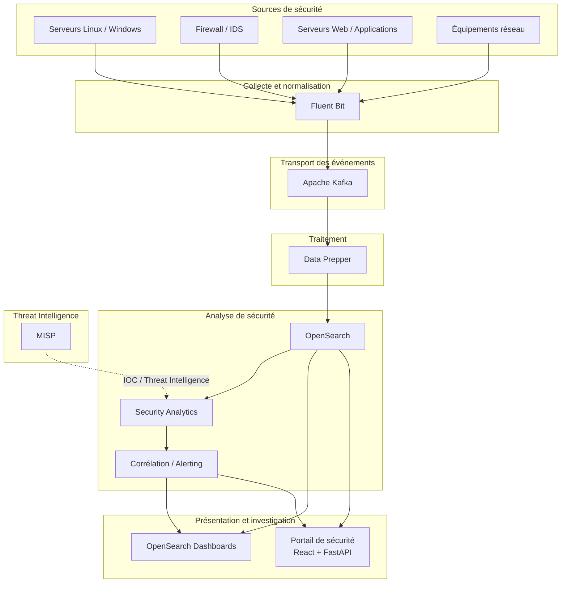
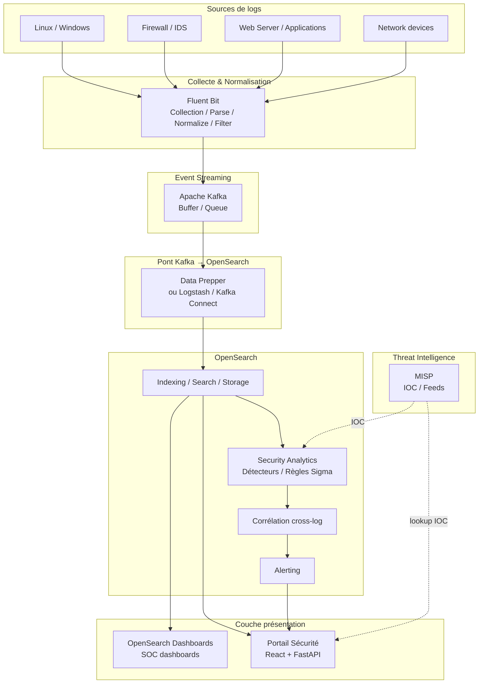
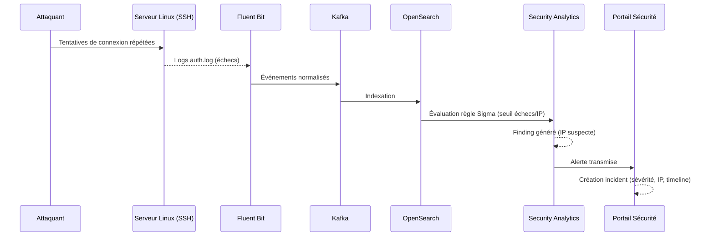
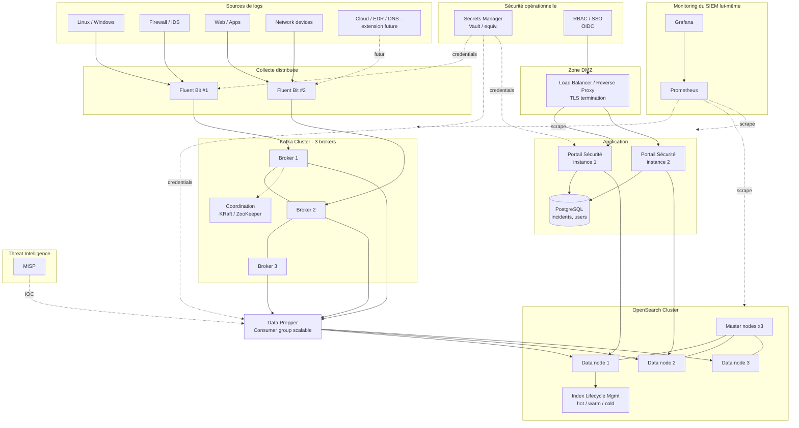

# Description du projet

> Mise en place d’une architecture distribuée de traitement, corrélation et analyse des événements de sécurité
> 

## 1. Architecture technique

## 2. Flux de détection

## 3. Architecture cible

---